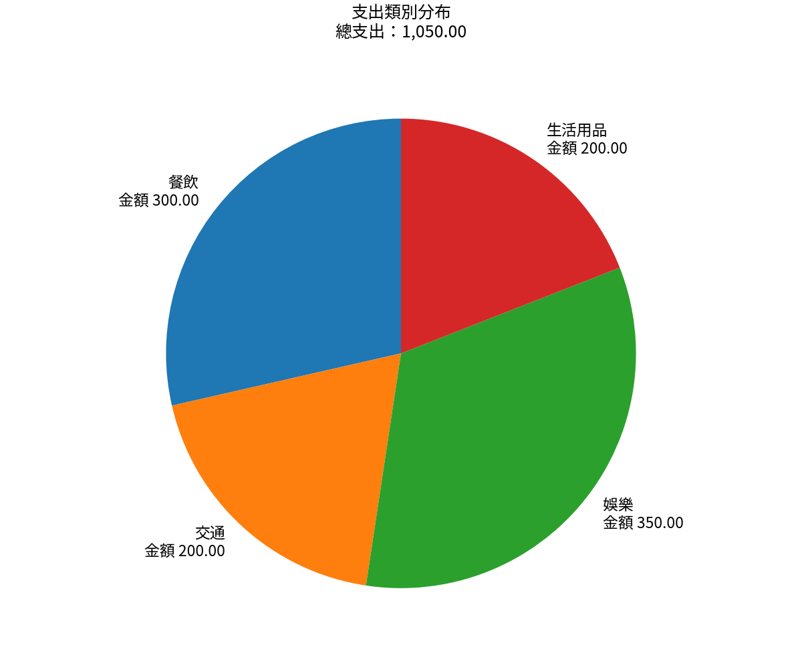

# 簡易記帳工具 v0.5

本版新增 **A 的 v0.5 日期／類別查詢功能**，接續既有修改與刪除功能。主選單選擇 `5` 可依日期範圍或類別查詢，並查看符合筆數與總金額。圓餅圖另外顯示各類別實際金額與總支出。詳細操作見 [A 的 v0.5 說明](docs/A_v05_query.md)。

軟體工程導論 Assignment 1 的共同基礎版本。使用 Python 輸入支出、儲存 CSV，並依各類別的**金額合計**產生圓餅圖。

## 功能

- 連續新增多筆支出：日期、金額、類別、選填備註。
- 日期留空使用今天；金額必須大於零且最多兩位小數。
- 支出追加至 CSV，重新啟動後資料仍保留。
- 讀取 CSV，依類別加總並顯示圓餅圖，同時標示各類別實際金額與總支出。
- 修改或確認後刪除既有支出。
- 依日期範圍與類別查詢支出，顯示筆數與金額合計。
- 輸入、視覺化與查詢模組可以獨立執行，也可由共同選單啟動。

## 環境設定

需要 **Python 3.10 以上**。圖表視窗請在有桌面介面的電腦執行，例如本機 VS Code 的終端機。

```bash
git clone https://github.com/1132954/-.git expense-tracker
cd expense-tracker
python -m venv .venv
```

啟用虛擬環境（依作業系統擇一）：

```powershell
# Windows PowerShell
.venv\Scripts\Activate.ps1
```

```bat
:: Windows 命令提示字元 CMD
.venv\Scripts\activate.bat
```

```bash
# macOS / Linux
source .venv/bin/activate
```

安裝套件：

```bash
python -m pip install -r requirements.txt
```

如果系統的 Python 指令是 `python3`，請將上述建立環境的 `python` 改成 `python3`。虛擬環境啟用後可使用 `python`。

## 執行方式

### 共同入口

```bash
python main.py
```

選單：`1` 新增、`2` 修改、`3` 刪除、`4` 圓餅圖、`5` 日期／類別查詢、`0` 結束。

輸入範例：

```text
日期 YYYY-MM-DD：2026-11-17
金額：85
類別（例如餐飲、交通）：餐飲
備註（可留空）：早餐
```

每筆儲存後可以繼續新增。**在下一筆的日期欄位輸入 `q`**，返回主選單；關閉圓餅圖視窗後也會回到選單。

### 成員 A：只執行輸入模組

```bash
python input_module.py
```

### A 的 v0.5：獨立查詢

```bash
python query_expenses.py --data data/sample_expenses.csv --start 2026-11-16 --end 2026-11-17 --category 餐飲
```

這個範例會找到 2 筆支出，合計 215.00。日期包含起訖日；類別完全符合，英文忽略大小寫。查詢不會改寫 CSV。

### 成員 B：只執行視覺化模組

```bash
python visualization.py
```

預設資料位置是專案內的 `data/expenses.csv`，首次新增時自動建立。這個檔案不會提交到 Git，以免兩人的個人記帳資料互相覆蓋。

四個入口皆支援 `--data` 指定其他 CSV。例如用同一份練習資料執行：

```bash
python input_module.py --data data/practice.csv
python visualization.py --data data/practice.csv
python main.py --data data/practice.csv
```

若要保存自己的記帳資料，請另外備份 CSV；`data/practice.csv` 等自訂路徑請自行確認是否要提交。

## 不需輸入即可看範例

```bash
python visualization.py --data data/sample_expenses.csv
```

範例共 7 筆支出：餐飲 300、交通 200、娛樂 350、生活用品 200，總計 1,050。



程式會自動選用常見中文字型。Windows 通常使用 Microsoft JhengHei，macOS 使用 PingFang TC；Linux 建議安裝 Noto Sans CJK。若中文顯示方框，請安裝中文字型後重新啟動程式。

## 模組與共用介面

| 檔案 | 負責範圍 |
| --- | --- |
| `main.py` | 共同選單入口 |
| `input_module.py` | 既有新增、修改、刪除支出流程 |
| `query_expenses.py` | A：v0.5 日期／類別查詢 |
| `visualization.py` | B：類別統計與圖表 |
| `storage.py` | 共用：CSV 格式、讀取與追加儲存 |
| `data/sample_expenses.csv` | 可提交的固定範例資料 |
| `tests/` | 基礎、修改與查詢的自動驗證 |

CSV 欄位固定依序為：

```csv
date,amount,category,notes
2026-11-17,85.00,餐飲,早餐
```

- `date`：日期，`YYYY-MM-DD`。
- `amount`：正數金額，最多兩位小數；以 Decimal 運算，寫入 CSV 時固定兩位小數。
- `category`：非空白的類別文字。
- `notes`：可空白；含逗號、引號或換行時由 CSV 模組自動處理。
- CSV 使用 UTF-8 BOM，方便試算表軟體辨識中文。

A 透過 `make_expense(...)` 建立資料，再呼叫 `append_expense(expense, path)`。B 透過 `load_expenses(path)` 取得 `list[Expense]`；`category_totals(...)` 回傳各類別總金額，`create_pie_chart(path)` 回傳 Figure，無資料時回傳 None。

變更共用欄位或介面前，兩位成員應先確認，避免輸入與視覺化模組讀寫不同格式。

## 後續協作方式

這次是共同起點；兩人的分支開發與合併紀錄，要從後續實際新增的功能建立。每次版本更新使用獨立功能分支；開發期間可以有多次有意義的 commit，確認功能與測試後再合併。

目前版本順序依實際整合調整如下：

| 版本 | 功能 | 狀態／分支 |
| --- | --- | --- |
| v0.3 | 修改既有支出 | 已合併：`feature/a-v0.3-edit-expense` |
| v0.4 | 刪除指定支出 | 已有合併紀錄：`feature-delete-expense` |
| v0.5 | 日期／類別查詢與圓餅圖金額標示 | 本次預備：`feature/a-v0.5-query-expense` |

專案看板可使用「待辦 → 開發中 → 待檢查 → 完成」。完成套件不等於已提交或合併，請由各成員使用自己的 Git 身分提交並推送。

開始一項功能時，先更新主線，再建立分支：

```bash
git switch main
git pull --ff-only origin main
git switch -c feature/a-v0.5-query-expense
```

開發與測試後，提交這項功能的相關檔案並推送分支：

```bash
git add main.py README.md query_expenses.py visualization.py docs/A_v05_query.md docs/sample_pie_chart.png tests/test_query_expenses.py tests/test_chart_amounts.py
git commit -m "feat(input): add date and category expense queries as v0.5"
git push -u origin feature/a-v0.5-query-expense
```

請依實際修改內容調整檔案清單與提交訊息。每人使用自己的 Git 姓名與電子郵件提交，保留真實貢獻紀錄。

另一位成員檢查後，執行整合。以下指令也適用於分支由另一台裝置推送到相同儲存庫的情況：

```bash
git switch main
git pull --ff-only origin main
git fetch origin
git merge --no-ff origin/feature/a-v0.5-query-expense -m "Merge v0.5 expense query feature"
python -m unittest discover -s tests -v
git push origin main
```

`--no-ff` 會保留 merge commit，方便在分支圖看到合併。若出現衝突，先協調修正、完成合併並重新測試，再推送。兩人可以同時開發；每次整合完成後，下一項功能需以最新主線確認相容性。

## 驗證

```bash
python -m unittest discover -s tests -v
```

測試涵蓋 CSV 追加與重新讀取、中文及特殊字元、精確金額加總、無資料狀態、錯誤資料保護、依金額比例繪圖，以及日期／類別查詢、修改刪除後的相容性，以及圖表實際金額標示。測試在暫存目錄中執行，不會修改個人記帳資料。

最後繳交仍需由兩位成員完成：實際貢獻與分支合併紀錄、Insights → Network 截圖、展示影片與影片連結。本版本附上原始碼、執行說明、範例資料及範例圓餅圖。
